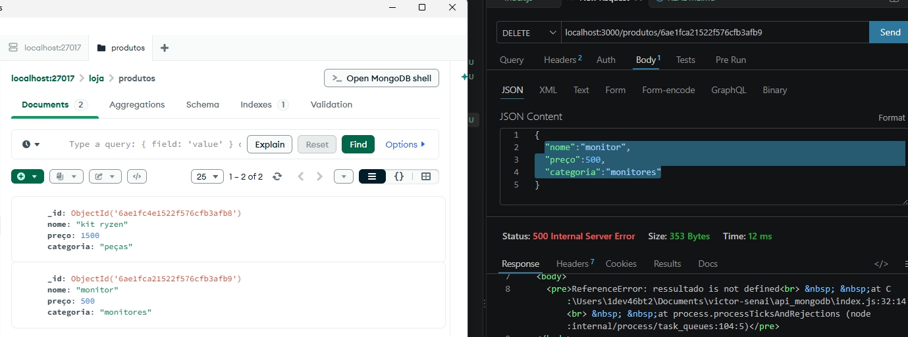
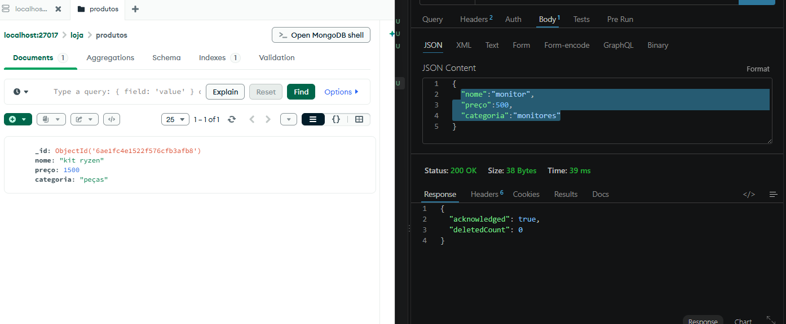
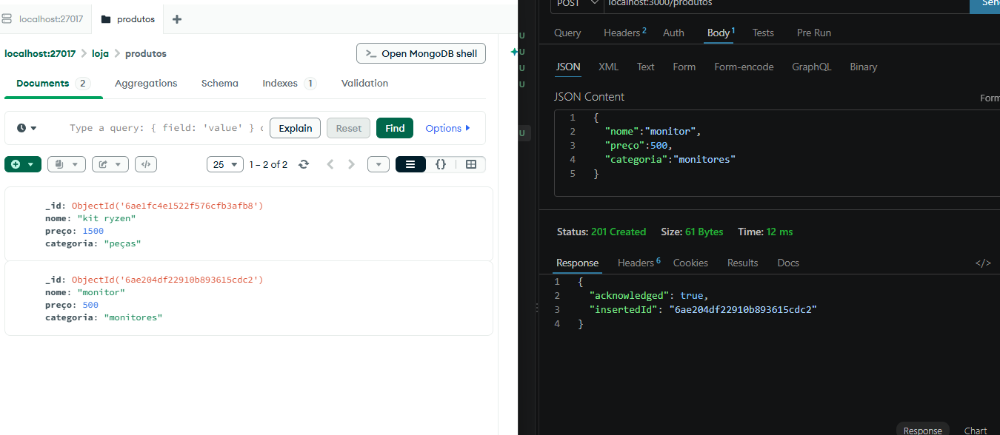
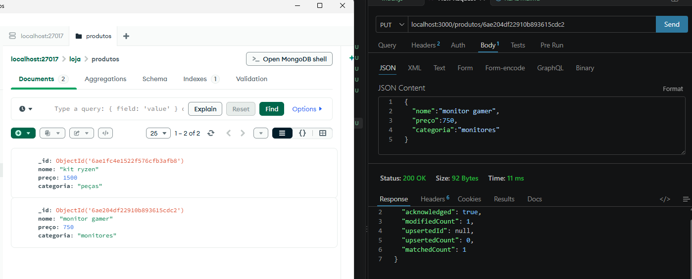
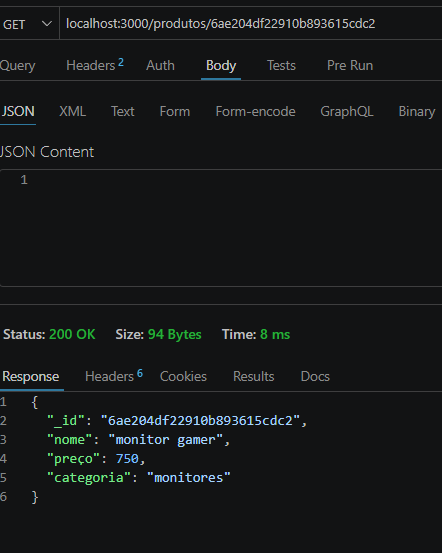
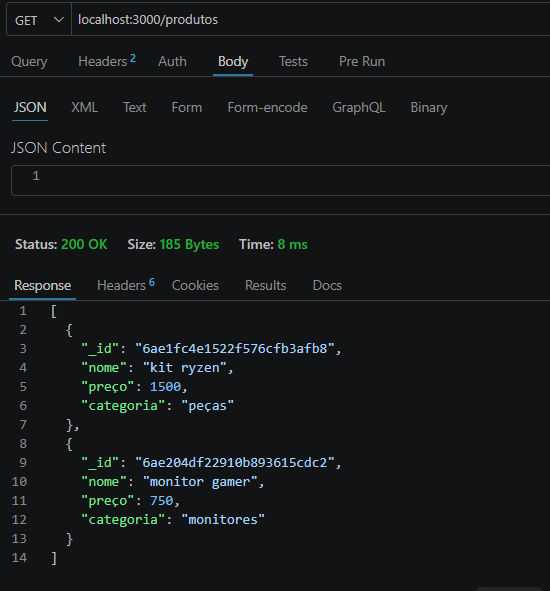

# Expliacação de funcionamento
o Mongodb é um banco de daos *Não relacional*, ou seja ao invés de utilizar tabelas ele utiliza coleções e permite coisas como
>"preço":"victor",
isso não é permitido em bancos como o postgres. 
Uma coleção significa que eu posso colocar o que eu quiser dentro dela, por exemplo, se eu tenho uma coleção de Flesh And Blood eu posso colocar cartas de magic ou vice-versa; caso isso fosse uma tabela eu poderia apenas colocar cartas de um jogo e não de outro.
Para este projeto foi utilizado a versão local do Mongo

## Guia de instalação
1. Clone este repositório
2. entre no link: https://www.mongodb.com/try/download/community-kubernetes-operator
3. Instale a versão para o seu sistema operacional.
4. Entre no VScode e crie o arquivo ".env" direto na pasta mão do projeto.
5. crie um novo banco de dados no aplicativo do Mongo.
6. No terminal do vs code digite os comandos:
>npm init -y 
>npm install mongodb express
7. No arquivo .env cole o texto: MONGO_URI=mongodb://127.0.0.1:27017.

## Guia de funcionamento
1. O arquivo env guarda todas as informações para entrar e acessar seu banco de dados, ou seja quuem tenho os dados dele poderá -e vai- alterar seus dados inseridos no banco, então tome cuidado para não expor ou vazar o .env

2. As bibliotecas instaladas pelos comandos são essenciais para que o banco funcione e principalmente para que o banco entenda e execute o que queremos.
> não adianta pedir algo em italiano para quem só fala mexicano, ele não vai entender. Aqui é a mesma coisa, banco de daos em sua maioria se comunicam em SQL e para o projeto usamos JS, duas linguagens diferentes, então precisamos de um tradutor.

Para demonstrar o funcionamento utilizarei a extensão do VScode, Thunderclient. Para acessar o banco de dados digite na parte superior do Thuenderclient: localhost:3000/produtos. *Para fazer buscas utilizando o id, coloque após o link "/" e coloqeu o id*

## Demonstação

### Delete

Agora vamos deletar o monitor

O método Delete serve para deletar algum item desejado, aqui você deve deletar um a um caso queira deletar mais de 1 item, pois ele deleta por id e é impossivel haver mais de um id em um banco de dados

### Post
O método post serve para adicionar um novo produto em nosso Banco de dados

### Update
Este método serve para atualizarmos um produto ou item *já postado no banco*, ele serve apenas para o id, então caso queira alterar mais de um, terá de alterar um por vez

### Get
por fim o Get, ele busca um item e te mostra todas as informações dele. Aqui vale ressaltar que ele pode buscar todos os item ou apenas um, para isso basta adicionar o id ou não

aqui buscamos apenas um item

aqui conseguimos pegar todos os items